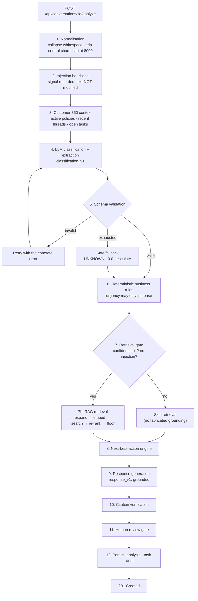

# AI Pipeline

End-to-end description of what happens between an inbound message and a
reviewable draft, and what happens when each step fails.

Entry point: `backend/app/services/workflows/pipeline.py`.

---

## Overview



---

## Stage by stage

### 1. Normalisation — `utils/text.normalize_message`

Unicode NFC, control characters removed, runs of spaces collapsed, trailing
whitespace per line stripped, capped at 8 000 characters.

Deliberately conservative: accents, punctuation and emoji are **kept**, because
they carry signal. An angry `!!!` matters for complaint detection; stripping
accents would destroy the difference between *"papá"* and *"papa"*.

**Failure:** an empty message raises `ValueError` before any API call is made,
surfaced as HTTP 422. Never spend a token on an empty string.

### 2. Injection heuristics — `utils.text.detect_injection`

~13 regex patterns over accent-folded text, covering English and Spanish
phrasings ("ignore your instructions", "olvida tus instrucciones", "muéstrame
información de otros clientes").

This is a **signal, not a filter**. The actual defences are structural:

- customer text is always wrapped in explicit delimiters and labelled untrusted;
- the prompt instructs the model to treat it as data;
- **no tool or query in this system can read another customer's row** — the
  context builder takes one customer object and selects from it.

A match sets `PROMPT_INJECTION_SUSPECTED`, which skips retrieval, forces
escalation to `COMPLIANCE_TEAM`, and writes an audit entry.

### 3. Customer context — `workflows/context.py`

Two competing goals: the model needs enough business state to be useful, and the
prompt must not become a database dump — irrelevant context costs tokens, dilutes
attention and widens the blast radius of an injection.

So the selection is explicit and capped: at most 6 active policies (soonest
expiry first), 4 recent conversations, 4 open tasks. Never another customer,
never internal notes.

Rendered as compact Markdown, which models read reliably.

### 4. Classification — prompt `classification_v1`

The prompt is a file (`app/prompts/classification_v1.md`), not a string literal.
Its enum lists are **generated from the Python enums** at render time, so the
prompt cannot drift from the validator.

It instructs the model to: emit only JSON; use only the listed enum values;
extract only facts literally present; treat the customer message as untrusted
data; and report confidence honestly, with an explicit example that a vague
message must score below 0.5.

**Temperature 0.1.** This is analytical work and needs to be reproducible.

### 5. Schema validation — `schemas/ai_output.MessageAnalysis`

The single most important reliability control. An invalid label can never reach
the database, the routing engine or the UI.

Handled tolerantly (coerced, because they are formatting noise rather than
semantic errors):

| Model quirk | Handling |
|---|---|
| Prose around the JSON | Balanced-brace extraction that ignores braces inside strings |
| Markdown fences | Stripped |
| `confidence: 94` | Rescaled to `0.94` |
| `injuries: "no"` / `"sí"` | Coerced to boolean |
| `vehicle_plate: "1234 abc"` | Normalised to `1234ABC` |
| `missing_information: "photos"` | Wrapped into a list |
| Unknown intent label | Falls back to `UNKNOWN` |

Handled strictly (rejected, triggering a retry):

| Violation | Why strict |
|---|---|
| Unknown **urgency** value | Urgency drives escalation; guessing it is unsafe |
| Non-numeric confidence | Meaningless input to the review gate |
| Missing `summary` | The operator-facing field |
| `UNKNOWN` intent with confidence > 0.6 | Internally incoherent; capped to 0.4 |

**Retries are informed**: the validation error is appended to the retry prompt.
A blind retry wastes a call.

Provider errors are classified: 429/408/5xx are retryable, other 4xx (a bad API
key) are not, and fail immediately rather than burning the retry budget.

**Failure:** after `LLM_MAX_RETRIES + 1` attempts, `AnalysisFailure` is raised
and the pipeline substitutes a **safe fallback** — `UNKNOWN`, confidence `0.0`,
`ESCALATE_TO_HUMAN`, review required, `fallback_used = true` — and writes an
`AI_OUTPUT_VALIDATION_FAILED` audit entry. The product degrades; it does not
produce a confident wrong answer, and it does not 500.

### 6. Business rules — `workflows/business_rules.py`

See [ARCHITECTURE.md §5](ARCHITECTURE.md#5-why-deterministic-rules-complement-the-llm)
for the reasoning. The rules:

| Rule | Trigger | Result |
|---|---|---|
| `injuries_reported` | `injuries == true` | `CRITICAL` |
| `claim_on_expired_policy` | `CLAIM` + policy past expiry | ≥ `HIGH` |
| `claim_minimum_urgency` | any `CLAIM` | ≥ `MEDIUM` |
| `payment_on_lapsed_policy` | `PAYMENT` + policy `LAPSED` | ≥ `HIGH` |
| `payment_close_to_expiry` | `PAYMENT` + ≤ 15 days to expiry | ≥ `HIGH` |
| `renewal_imminent` | `RENEWAL` + ≤ 7 days | ≥ `HIGH` |
| `renewal_approaching` | `RENEWAL` + ≤ 30 days | ≥ `MEDIUM` |
| `complaint_minimum_urgency` | any `COMPLAINT` | ≥ `HIGH` |
| `cancellation_minimum_urgency` | any `CANCELLATION` | ≥ `MEDIUM` |

Each override is stored with `from`, `to` and a human-readable reason, and shown
in the UI. Urgency can only increase.

### 7. Retrieval gate, then RAG

**The gate comes first.** Retrieval is skipped when:

- an injection is suspected — the text is not a description of an insurance
  need, so grounding it is meaningless; or
- confidence is below the routing floor (0.45), or the intent is `UNKNOWN` /
  `GENERAL_SUPPORT`.

The second condition matters more than it looks. If the system does not know
what the customer wants, it cannot know which procedure is relevant — and
retrieving anyway produces *confident-looking citations attached to an answer
nobody should trust*. Returning nothing lets the generator say so honestly.

When the gate passes: expand the query with intent and product vocabulary,
embed, search, apply the category re-rank, drop everything below the similarity
floor.

**Failure:** retrieval is wrapped in a try/except. If the vector store fails, the
analysis still completes with zero sources and is therefore ungrounded and
review-required. An enhancement failing must not lose the classification.

### 8. Next-best-action — `workflows/action_engine.py`

Gates first, then intent routing, then a final escalation check:

1. **Injection** → `ESCALATE_TO_HUMAN` / `COMPLIANCE_TEAM`.
2. **Confidence < 0.45 or `UNKNOWN`** → `REQUEST_CLARIFICATION`. The system asks
   rather than guesses.
3. **Intent routing** — e.g. `CLAIM` with missing information →
   `REQUEST_DOCUMENTS`; `CLAIM` complete → `CREATE_CLAIM_CASE`.
4. **`CRITICAL` urgency** overrides the routed action with `ESCALATE_TO_HUMAN`.

Output: `action + team + follow-up hours + human_review_required + reason`. The
reason string is what the operator reads and what an auditor reads later.

Follow-up SLA is business configuration, not model output:
`CRITICAL 1h · HIGH 4h · MEDIUM 12h · LOW 48h`.

### 9. Response generation — prompt `response_v1`

A separate call with a separate prompt, on purpose: different failure modes, and
a classification that succeeds should still produce routing even if drafting
fails.

The prompt binds the model to the retrieved knowledge for **all procedural
facts**, forbids inventing coverage amounts, premiums, exclusions, advisor names,
phone numbers and URLs, and requires an explicit
`insufficient_information: true` when the knowledge does not support an answer.

**Failure:** on `AnalysisFailure`, a fixed, honest holding reply is returned with
`grounded: false` and `insufficient_information: true`. The analysis survives.

### 10. Citation verification

A model can claim grounding it does not have. So the pipeline checks its work:

```python
valid = {chunk.citation for chunk in retrieved}
response.used_sources = [s for s in response.used_sources if s in valid]
if not retrieved:            response.grounded = False
elif not response.used_sources: response.grounded = False
```

Sources that were not actually retrieved are stripped before storage. Claiming
grounding while citing nothing is treated as ungrounded, which sends the draft to
the review gate.

### 11. Human review gate — `workflows/review_policy.py`

See [ARCHITECTURE.md §7](ARCHITECTURE.md#7-human-in-the-loop). Produces
`required`, a list of human-readable `reasons` shown in the UI, and
`auto_approval_eligible`.

### 12. Persistence and audit

One transaction writes: the `AIAnalysis` row (including model, prompt version,
latency, attempts, rule overrides, safety flags and retrieved sources), the
conversation status transition, the routed team, a `Task` with a due date, and
the audit entries — `AI_ANALYSIS_CREATED` (or `AI_ANALYSIS_FAILED`),
`TASK_CREATED`, one `BUSINESS_RULE_OVERRIDE` per rule that fired, and
`PROMPT_INJECTION_SUSPECTED` if flagged.

---

## Failure summary

| Failure | Behaviour | Visible as |
|---|---|---|
| Empty message | Rejected before any API call | HTTP 422 |
| No API key | Demo mode at startup | "Demo AI Mode" banner; `demo_mode=true` on every row |
| Provider timeout / 5xx / 429 | Retried | `validation_attempts` in metadata |
| Bad API key (401) | Not retried | Fallback analysis + audit entry |
| Malformed JSON | Retried with the parse error | `validation_attempts` |
| Schema violation | Retried with the validation error | `validation_attempts` |
| All retries exhausted | Safe fallback: `UNKNOWN`, escalate | `AI_OUTPUT_VALIDATION_FAILED` audit entry |
| Vector store error | Analysis completes ungrounded | 0 sources, review required |
| No RAG results | Explicit refusal, holding reply | "insufficient information" callout |
| Response generation fails | Fixed holding reply | `grounded=false`, review required |
| Duplicate analyse request | Rejected unless `force: true` | HTTP 409 |
| Double review | Rejected | HTTP 409 |

---

## Prompt versioning

Prompts live in `backend/app/prompts/` as Markdown with frontmatter, loaded by a
small registry. `prompt_version` is stored on every analysis.

| Prompt | Purpose | Output contract |
|---|---|---|
| `classification_v1` | Classify + extract | `MessageAnalysis` |
| `response_v1` | Draft the customer reply | `GeneratedResponse` |
| `rag_answer_v1` | Answer an internal question from the KB | `GeneratedResponse` |

To change a prompt: add `classification_v2.md`, switch the constant, re-run
`flask evaluate`, and compare the two runs in the Evaluations screen. That
comparison is the reason runs are persisted.

---

## Observability

Every log line and audit row carries a `request_id`, propagated from the
`X-Request-ID` header or generated per request, and echoed back in the response.

Logged: request method/path/status/duration, AI invocation with model and
latency, parse and validation failures with the reason, retrieval backend and
result counts, rule overrides, human reviews, evaluation runs.

**Not logged:** message bodies and draft responses. `redact()` exists for the few
places where an excerpt genuinely helps debugging (it masks emails, phones, IBANs
and plates), and `LOG_MESSAGE_BODIES` defaults to `false`.
