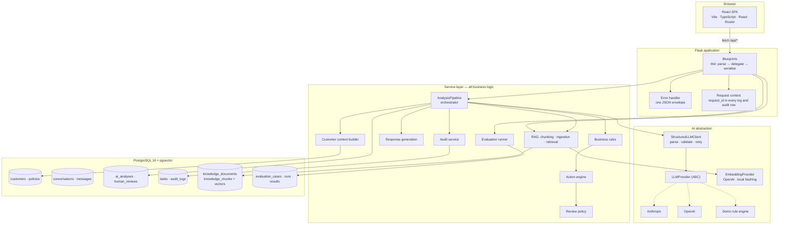
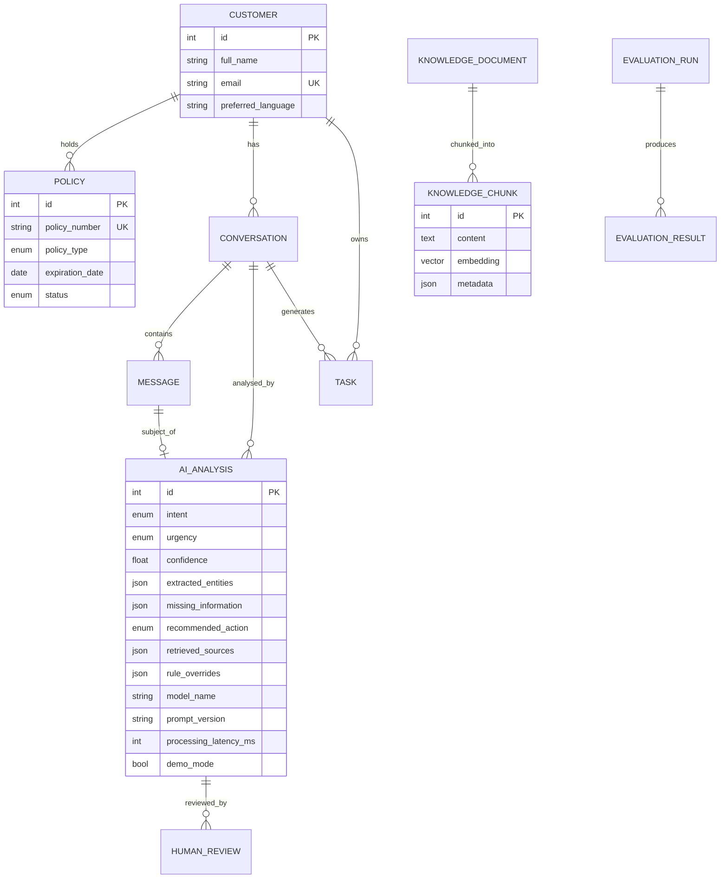
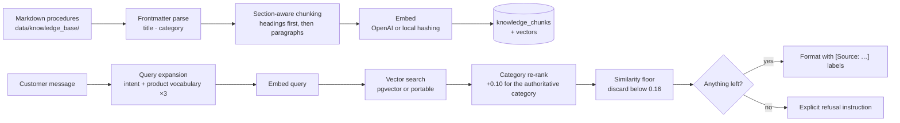

# Architecture

This document explains how the system is put together and, more importantly,
**why** — including the trade-offs I would defend in review and the ones I would
revisit for production.

---

## 1. Guiding principle

> The LLM is a component inside a controlled business workflow, not the workflow.

Everything below follows from that. The model is good at reading messy Spanish
prose and turning it into structure. It is not a system of record, it is not
stable across runs, and it cannot be held accountable. So the system uses it for
what it is good at and puts deterministic, testable code around every decision
with consequences.

---

## 2. Component overview



### Layer responsibilities

| Layer | Owns | Never does |
|---|---|---|
| **Routes** | HTTP parsing, validation, serialisation, status codes | Business logic, direct AI calls |
| **Services** | All decisions, persistence, orchestration | Know about HTTP |
| **AI abstraction** | Talking to providers, JSON parsing, retries | Business decisions |
| **Models** | Schema, relationships, serialisation shape | Workflow logic |
| **CLI (`app/cli.py`)** | Reproducible setup steps | Anything the API also needs |

Route handlers are deliberately boring. `POST /api/conversations/:id/analyze` is
about 40 lines: load, validate, guard against duplicates, delegate to the
pipeline, serialise. That is what makes the pipeline testable without HTTP and
the routes reviewable at a glance.

`create_app()` is wiring only — extensions, CORS, the AI stack, blueprints,
error handlers. The CLI commands live in `app/cli.py` so the factory stays a
short list a reviewer can read top to bottom.

`AnalysisPipeline.analyze_conversation()` follows the same rule: it reads as
four named steps (`_save_analysis` → `_route_conversation` → `_create_task` →
`_audit`) inside one transaction, rather than one long function mixing
persistence, routing and auditing.

---

## 3. Data model



### Why relational storage

The domain is relational. A policy belongs to exactly one customer, a message to
exactly one conversation, a review to exactly one analysis. Those are foreign
keys with real integrity guarantees, not documents that happen to reference each
other. The queries the product actually needs — "open conversations by team",
"policies expiring within 30 days", "analyses awaiting review" — are ordinary
SQL.

Vectors live in **one column of one table**. Storing them in the same database
means a retrieval result and the business record it relates to are one join
apart, with one transaction and one backup. A separate vector database would be
a second system to run, secure and keep consistent, for no benefit at this scale.

### Why AI output is a first-class table, not a JSON blob on the conversation

`ai_analyses` stores the model name, the prompt version, the latency, the number
of validation attempts, the rule overrides that fired and the exact chunks that
were retrieved. That is what makes the question *"why did the system recommend
this, six months ago?"* answerable. Re-analysing appends a row rather than
overwriting one, so the history is intact.

### Two portability decisions

1. **Enums are `VARCHAR` + `CHECK`, not native PostgreSQL enums.**
   Native enums make migrations painful (`ALTER TYPE` cannot share a transaction
   with other DDL), and this taxonomy is expected to grow. The check constraint
   gives the same safety with none of the migration pain.

2. **`knowledge_chunks.embedding` is a dialect-aware column type.**
   It compiles to a real `vector(n)` on PostgreSQL and to JSON elsewhere
   (`app/models/base.py`). The consequence — the dimension is fixed at migration
   time — is a real constraint, documented in `.env.example`: switching embedding
   provider requires a migration and a full re-ingest.

---

## 4. The AI abstraction

```
LLMProvider (ABC)
├── AnthropicProvider     # thin adapter
├── OpenAIProvider        # thin adapter, JSON mode
└── DemoProvider          # deterministic rule engine, same contract
        ↑
StructuredLLMClient       # parse → validate → retry → fail safe
        ↑
AnalysisPipeline          # never imports a vendor SDK
```

Provider classes contain **no prompt construction, no parsing and no business
logic** — only "send these strings, return that string, translate errors". All
the interesting behaviour is in `StructuredLLMClient`, which is provider-agnostic
and therefore tested once for every provider.

The demo provider is the proof the abstraction is real: it satisfies the same
interface with no network at all.

**How the mock recovers structure.** A provider only ever receives two strings,
so DEMO MODE has to work out what is being asked of it. It reads exactly two
machine-readable markers that the prompt renderer emits and this project owns —
the `<<<CUSTOMER_MESSAGE_START ... CUSTOMER_MESSAGE_END>>>` delimiters and the
`[Source: ...]` citation labels — and derives everything else (intent, missing
information) by running the same `demo_rules.analyse()` over the extracted
message. It deliberately does **not** parse the prose of the prompt: an earlier
version keyed off the English sentence "Missing information we need from the
customer", which would have silently broken the demo the first time anyone
reworded a prompt.

**Trade-off:** the interface is deliberately minimal — one `complete(system,
user)` call. No streaming, no tool use, no multi-turn. Those would each need a
reason to exist, and this workflow does not need them: a classification is a
single call whose output is consumed by code, not read as it arrives.

---

## 5. Why deterministic rules complement the LLM

This is the most important design decision in the project.

Consider: *"Se me ha devuelto el recibo del seguro del coche."* The correct
urgency is not a property of the sentence — it depends on data the message does
not contain. If the policy expires in nine days, coverage is about to lapse and
this is `HIGH`. If it expires in eight months, it is routine `MEDIUM`.

An LLM given the customer context might get this right. It might also get it
right on Monday and wrong on Tuesday, and there is no way to unit-test "usually".
So:

- **The model reports what the message says.** Baseline urgency, extracted facts,
  what is missing.
- **`business_rules.py` decides what the brokerage does about it**, reading real
  policy state from the database.

Every rule is a named function with a threshold constant, a reason string and a
unit test. `renewal_imminent` fires when `days_to_expiration <= 7`. That is
readable by a compliance officer and changeable without touching a prompt.

**Rules only ever raise urgency, never lower it.** A model that over-reports
severity costs an operator five minutes. A model that under-reports an injury
costs much more. The asymmetry is deliberate, and its cost is measured — the
evaluation suite reports the false-alarm rate alongside the safety recall.

---

## 6. RAG design



**Chunk on sections, not fixed windows.** Insurance procedures are structured
("3. Documentación obligatoria"), and that structure is exactly what makes a
citation useful to an operator. A sliding window would cut requirement lists in
half and cite "chunk 7".

**Query expansion.** A raw WhatsApp message is a poor query against a procedure
manual, so the classified intent's domain vocabulary is appended once. An
earlier version repeated it three times to weight it more heavily in the
bag-of-features embedder; measuring showed that made top-1 document accuracy
*worse* (4/5 vs 5/5 on a hand-checked set), so it was removed.

**Category re-ranking.** A small, explicit `+0.10` boost for chunks whose
document category matches the intent — a light hybrid of vector similarity and
document metadata. This, not the expansion weighting, is what actually fixes
retrieval with the lexical hashing embedder, where documents share common
vocabulary ("plazo", "documentación", "comunicación").

**A similarity floor, so "nothing" is a real answer.** Below the floor, results
are discarded rather than returned weakly. This is what lets the response
generator refuse honestly instead of citing an irrelevant procedure.

**Trade-off:** the portable vector store loads every chunk into Python and ranks
them there. That is O(n) per query and obviously wrong beyond a few thousand
chunks — which is why pgvector is the Docker path. The interface is identical;
only the implementation differs, selected by database dialect.

---

## 7. Human-in-the-loop

Review necessity is computed by `review_policy.py` from four inputs: intent risk
class, urgency, confidence, and whether the draft is grounded. It is code, not a
model call, because *"must a human look at this?"* is a governance rule that
someone signs off on.

```
Always requires review:
  · CLAIM, COMPLAINT, CANCELLATION, PAYMENT   (legal/financial consequence)
  · urgency >= HIGH
  · confidence < AI_CONFIDENCE_THRESHOLD
  · intent UNKNOWN
  · any safety flag
  · ungrounded or insufficient-information drafts

Auto-approval *eligible* (never automatic) only when ALL hold:
  · intent in {POLICY_INFORMATION, DOCUMENT_REQUEST, GENERAL_SUPPORT}
  · confidence >= threshold
  · urgency <= MEDIUM
  · draft is grounded in retrieved sources
  · not demo mode
```

Note that demo mode removes auto-approval eligibility but does **not** add a
review reason. That is deliberate: `required` measures the governance policy
itself, and it must stay comparable between demo-mode and real-LLM evaluation
runs. Making mock output non-eligible for auto-approval is the control that
actually matters.

Nothing is ever sent. `HumanReview.simulated_send` records the *intent* to send,
and an audit row marks `delivery: SIMULATED_ONLY`. Wiring a real channel would
replace one function.

---

## 8. Auditability

One helper, `record_audit()`, used everywhere, so entries cannot drift into
inconsistent shapes. It stages the row inside the caller's transaction — an audit
record and the thing it describes commit together or not at all.

Every entry carries the `request_id` from the HTTP request, which also appears in
every log line. A recommendation in the database can be traced back to the exact
request and its logs.

**Message bodies and draft responses are never written to the audit trail.**
`_sanitise()` strips them by key. The data here is synthetic, but the code is
written as though it were not.

---

## 9. Frontend architecture

Deliberately small: a typed `api/client.ts`, a ~60-line `useApi` hook, page
components, and presentational primitives.

**No react-query, no Redux.** Eight screens with simple request/refetch needs do
not justify either. The hook handles the two things that actually bite —
unmount-safety and stale-response ordering (an earlier request resolving after a
later one). If caching or optimistic updates were needed, that trade-off would
flip.

**No component library.** ~700 lines of CSS with design tokens, versus a
dependency whose theming a reviewer would have to learn. For an internal tool
with this surface area, the CSS is smaller than the configuration would be.

**No mock API layer.** Every screen talks to the real backend. A mocked frontend
hides integration bugs, which are the ones that matter.

State flows down from the page. After an analysis or a review the whole
conversation is refetched rather than patched locally, because the backend owns
status transitions, task creation and audit entries — reconstructing that
client-side would be duplicating business logic in TypeScript.

---

## 10. Known architectural compromises

| Compromise | Why it is acceptable here | What production needs |
|---|---|---|
| Inbox filters on AI labels in Python | Intent lives on the latest analysis; a SQL filter needs a correlated "latest per conversation" subquery. Not worth it at POC volume. | Denormalised `latest_analysis_id` on `conversations`, or a materialised view |
| Synchronous analysis inside the HTTP request | Latency is ~100 ms in demo mode, a few seconds with a real model. Acceptable for an operator-triggered action. | Job queue with retries and dead-lettering |
| Embedding dimension fixed at migration time | One migration, clearly documented | Per-collection dimension, or a dedicated vector service |
| Single tenant, single hardcoded operator | Auth is explicitly out of scope for this POC | SSO + RBAC, real identity in the audit trail |
| Prompt registry loaded from disk at import | Prompts are code-adjacent and version-controlled | Same, plus a prompt-change CI gate on evaluation metrics |

Nothing here is hidden behind an abstraction that pretends to solve it. Each is a
sized, named piece of work.
