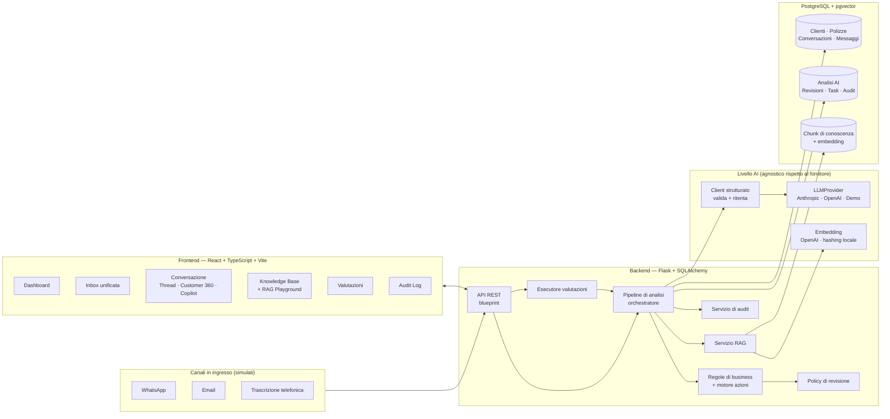
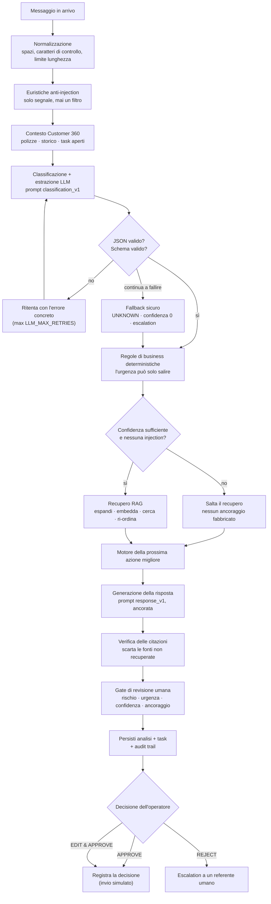

# Insurance Conversation Intelligence — AI Case Copilot

*Traduzione italiana di [`README.md`](../../README.md). In caso di divergenza, vince l'originale (e il codice).*

Un proof of concept funzionante di uno strumento interno per un broker
assicurativo spagnolo: i messaggi in arrivo dai clienti via **WhatsApp, email e
trascrizioni telefoniche** vengono trasformati in **casi strutturati, instradati
e tracciabili**, con un essere umano che approva ogni risposta diretta al cliente.

> **Tutti i dati in questo repository sono sintetici.** Clienti, polizze,
> conversazioni e manuali di procedura sono inventati a scopo dimostrativo. Non è
> presente alcun dato personale reale, né materiale proprietario di alcuna
> azienda.

---

## 1. Perché questo progetto esiste

I broker annegano nei messaggi in arrivo non strutturati. La mossa ovvia — «mettici
sopra un chatbot» — è quella sbagliata: le risposte su sinistri, disdette e
pagamenti hanno conseguenze legali e finanziarie, e un modello linguistico non è
un sistema di registrazione (*system of record*).

Questo progetto prende quindi la posizione opposta:

> **L'LLM è un componente dentro un flusso di lavoro aziendale controllato — mai
> il motore decisionale.**

In concreto significa che il modello classifica ed estrae, e poi **codice
deterministico possiede ogni decisione che conta**: urgenza, instradamento, se
serve la firma di un umano. L'output del modello è validato contro uno schema
rigoroso prima che qualsiasi cosa tocchi il database, le risposte sono ancorate
alle procedure interne recuperate, e nulla raggiunge un cliente senza un click.

---

## 2. Cosa fa

Dato questo messaggio WhatsApp:

> *«Hola, ayer tuve un golpe con el coche. No hubo heridos pero tengo el
> paragolpes roto. Mi matrícula es 1234ABC. ¿Qué tengo que enviaros?»*
>
> (*«Ciao, ieri ho avuto un urto con l'auto. Non ci sono stati feriti ma ho il
> paraurti rotto. La mia targa è 1234ABC. Cosa devo mandarvi?»*)

il sistema produce:

| Campo | Valore |
|---|---|
| Intento | `CLAIM` |
| Tipo assicurativo | `MOTOR` |
| Urgenza | `MEDIUM` |
| Confidenza | 0,93 |
| Estratto | targa `1234ABC`, data sinistro `ayer`, feriti `false`, danno `paragolpes roto` |
| Mancante | luogo del sinistro · coinvolgimento di terzi · numero di polizza · fotografie |
| Azione successiva | `REQUEST_DOCUMENTS` → `CLAIMS_TEAM`, follow-up entro 12 h |
| Revisione umana | **Necessaria** — intento ad alto rischio |
| Fonti | *Procedimiento de Siniestros de Automóvil, §3* · *Documentación Requerida para Siniestros* |
| Bozza di risposta | Risposta professionale in spagnolo con l'elenco dei documenti richiesti |

…più un elemento di lavoro (*task*) per il team sinistri e un audit trail completo.

---

## 3. Funzionalità chiave

- **Output LLM strutturato** — JSON validato con Pydantic, enum controllati,
  ritentativi informati, fallback sicuro. Un'etichetta inventata non può mai
  arrivare al database.
- **Regole di business deterministiche** — la presenza di feriti forza `CRITICAL`;
  un problema di pagamento su una polizza in scadenza fra 9 giorni diventa `HIGH`;
  i reclami sono sempre `HIGH`. Le regole possono solo *alzare* l'urgenza, e ogni
  override è memorizzato con la sua motivazione.
- **Motore della prossima azione migliore** — combina classificazione, stato del
  cliente, urgenza e informazioni mancanti in `azione + team + SLA + motivazione`.
- **RAG sulle procedure interne** — 10 manuali sintetici, suddivisione in chunk
  consapevole delle sezioni, ricerca vettoriale e **attribuzione visibile delle
  fonti** su ogni risposta.
- **Human-in-the-loop** — `APPROVE` / `EDIT_AND_APPROVE` / `REJECT`, conservando
  sia il testo originale sia quello finale. Nulla viene mai inviato in automatico.
- **Framework di valutazione** — 60 casi etichettati, risultati per singolo caso e
  una **metrica di sicurezza** (recall della revisione umana sui casi rischiosi),
  eseguibile dall'interfaccia.
- **Audit trail** — ogni analisi, override di regola, flag di sicurezza, task e
  decisione umana, correlati per request ID. I corpi dei messaggi sono
  deliberatamente esclusi.
- **Modalità demo** — funziona senza chiave API e senza infrastruttura, etichettata
  come mock ovunque compaia.

---

## 4. Architettura



Dettaglio completo, compromessi inclusi: **[02-ARCHITETTURA.md](02-ARCHITETTURA.md)**.

---

## 5. Pipeline AI



Dettaglio completo, gestione dei fallimenti inclusa: **[03-PIPELINE-AI.md](03-PIPELINE-AI.md)**.

---

## 6. Stack tecnologico

| Livello | Scelta | Perché |
|---|---|---|
| Backend | Python 3.12, Flask 3, SQLAlchemy 2 | Piccolo, esplicito, facile da leggere in revisione |
| Validazione | Pydantic v2 | Un solo schema guida il prompt, il DB e l'API |
| Database | PostgreSQL 16 + pgvector | Stato relazionale di business *e* vettori in un unico store |
| Migrazioni | Alembic / Flask-Migrate | Revisione iniziale autogenerata, rivista e corretta a mano per pgvector |
| Frontend | React 18, TypeScript, Vite, React Router | Standard, veloce, nessuna dipendenza UI pesante |
| Stile | CSS nativo con design token | ~730 righe, nessun framework da spiegare |
| AI | Anthropic o OpenAI, dietro un'interfaccia | Intercambiabili; la modalità demo non richiede nessuno dei due |
| Test | pytest (222) · Vitest + Testing Library (29) | LLM mockato; tutto il resto reale |
| Infrastruttura | Docker Compose (db · backend · frontend) | Un comando, tre servizi |

---

## 7. Struttura del repository

```
insurance-ai-copilot/
├── backend/
│   ├── app/
│   │   ├── __init__.py            # app factory (solo cablaggio)
│   │   ├── cli.py                 # flask bootstrap / seed / ingest-knowledge / evaluate
│   │   ├── config.py              # impostazioni da env, risoluzione della modalità demo
│   │   ├── extensions.py
│   │   ├── models/                # enums · customer · conversation · ai · knowledge · evaluation
│   │   ├── schemas/               # ai_output.py (contratti LLM) · api.py (validazione richieste)
│   │   ├── prompts/               # classification_v1.md · response_v1.md · rag_answer_v1.md
│   │   ├── routes/                # system · customers · conversations · analyses · knowledge · evaluations · audit
│   │   ├── services/
│   │   │   ├── ai/                # base · providers · demo_provider · demo_rules · embeddings · structured · factory
│   │   │   ├── rag/               # chunking · ingestion · vector_store · retriever
│   │   │   ├── workflows/         # context · business_rules · action_engine · review_policy · response_generation · pipeline
│   │   │   └── evaluation/        # metrics · runner
│   │   └── utils/                 # errors · request_context · text
│   ├── migrations/versions/       # schema iniziale Alembic
│   ├── scripts/seed_demo_data.py
│   ├── tests/                     # 222 test
│   ├── Dockerfile · entrypoint.sh · requirements.txt
├── frontend/
│   ├── src/
│   │   ├── api/client.ts          # unico client HTTP tipizzato
│   │   ├── components/            # Layout · CopilotPanel · Customer360 · ConversationThread · ui
│   │   ├── pages/                 # Dashboard · Inbox · ConversationDetail · Customers · CustomerDetail · KnowledgeBase · Evaluations · AuditLogs
│   │   ├── hooks/useApi.ts
│   │   ├── types/api.ts           # rispecchia i contratti del backend
│   │   └── styles/index.css
│   └── Dockerfile · nginx.conf
├── data/
│   ├── knowledge_base/            # 10 manuali di procedura sintetici (spagnolo)
│   ├── synthetic_cases/           # 8 conversazioni demo predisposte
│   └── evaluation/                # 60 casi di valutazione etichettati
├── docs/                          # ARCHITECTURE · AI_PIPELINE · EVALUATION · SECURITY_AND_LIMITATIONS
│   └── it/                        # questa documentazione in italiano
├── docker-compose.yml · .env.example · README.md
```

---

## 8. Come iniziare

### Opzione A — Docker (consigliata, un solo comando)

```bash
cp .env.example .env          # opzionale; i default sono sensati anche senza
docker compose up --build
```

Il container backend attende Postgres, applica le migrazioni, carica i dati demo
e ingerisce automaticamente la knowledge base.

- Frontend → <http://localhost:5173>
- Salute dell'API → <http://localhost:5001/api/health>

### Opzione B — Locale, senza alcuna infrastruttura

Il progetto gira deliberatamente **senza Docker, senza PostgreSQL e senza chiave
API**: ripiega su SQLite e sulla modalità demo. È il modo più rapido per esaminarlo.

```bash
# Backend
cd backend
python3 -m venv .venv && source .venv/bin/activate
pip install -r requirements.txt

export FLASK_APP=app:create_app
flask bootstrap                 # crea schema + seed + ingest, in un solo passo
flask run --port 5001
```

```bash
# Frontend (secondo terminale)
cd frontend
npm install
npm run dev                     # http://localhost:5173, fa da proxy di /api verso :5001
```

### Verifica

```bash
curl localhost:5001/api/health
# {"status":"ok","database":"ok","vector_backend":"portable-python","ai_demo_mode":true,...}
```

---

## 9. Variabili d'ambiente

Sono tutte opzionali — vedi **[.env.example](../../.env.example)** per l'elenco
commentato. Quelle che contano:

| Variabile | Default | Effetto |
|---|---|---|
| `DATABASE_URL` | file SQLite | Imposta un URL Postgres per usare pgvector |
| `LLM_PROVIDER` | *(vuoto)* | `anthropic` \| `openai` \| vuoto → modalità demo |
| `LLM_API_KEY` | *(vuoto)* | Chiave assente ⇒ modalità demo, mai un crash |
| `LLM_MODEL` | dipende dal fornitore | es. `claude-sonnet-4-20250514` |
| `AI_DEMO_MODE` | `false` | Forza l'AI mock anche con una chiave presente |
| `EMBEDDING_PROVIDER` | `hashing` | `openai` per embedding semantici reali |
| `EMBEDDING_DIMENSIONS` | `384` | **Fissato al momento della migrazione** — cambiarlo richiede una migrazione + re-ingest |
| `AI_CONFIDENCE_THRESHOLD` | `0.75` | Sotto questa soglia rivede sempre un umano |
| `RAG_TOP_K` | `5` | Chunk recuperati per query |
| `RAG_MIN_SIMILARITY` | `0.16` | Soglia sotto la quale i risultati vengono scartati |

---

## 10. Operazioni comuni

```bash
cd backend && export FLASK_APP=app:create_app

flask bootstrap             # schema + seed + ingest (aggiungi --reset per azzerare prima)
flask db upgrade            # solo migrazioni
flask seed                  # solo dati demo sintetici
flask ingest-knowledge      # (ri)costruisce il vector store; --force per ri-embeddare
flask evaluate              # esegue la suite etichettata e stampa le metriche
```

### Eseguire i test

```bash
cd backend && .venv/bin/python -m pytest        # 222 test
cd frontend && npm test                          # 29 test
```

Le chiamate LLM esterne sono mockate nella suite automatica, quindi gira offline e
in modo deterministico. Punta `LLM_API_KEY` a un fornitore reale ed esegui
`flask evaluate` per una verifica di integrazione dal vivo.

### Eseguire la valutazione

Dall'interfaccia: **Evaluations → Run evaluation**. Da CLI: `flask evaluate`.

**Baseline attuale in modalità demo** (il mock deterministico, 60 casi):

| Metrica | Risultato |
|---|---|
| Accuratezza intento | 91,7 % |
| Accuratezza urgenza | 85,0 % |
| Accuratezza tipo assicurativo | 93,3 % |
| Accuratezza azione | 96,7 % |
| Tasso di validazione dello schema | 100 % |
| F1 estrazione entità | 0,903 (P 0,82 / R 1,00) |
| **Recall della revisione umana sui casi rischiosi** | **97,4 %** |
| Tasso di falsi allarmi della revisione umana | 47,6 % |
| Latenza media | ~100 ms |

Questi sono i numeri della *baseline a parole chiave*, non di un modello
linguistico. È esattamente il punto: è il pavimento che un LLM reale deve
superare, ed è un confronto genuinamente utile. Vedi
**[04-VALUTAZIONE.md](04-VALUTAZIONE.md)**.

---

## 11. Usare un LLM reale

```bash
# .env
LLM_PROVIDER=anthropic
LLM_API_KEY=sk-ant-...
LLM_MODEL=claude-sonnet-4-20250514
```

Riavvia il backend. Il banner passa da **Demo AI Mode** a **Live AI**,
`ai_analyses.demo_mode` diventa `false`, e la stessa suite di valutazione ora
misura il modello. Per un recupero semantico reale imposta inoltre
`EMBEDDING_PROVIDER=openai`, `EMBEDDING_API_KEY=...` e `EMBEDDING_DIMENSIONS=1536`,
poi riesegui le migrazioni e `flask ingest-knowledge --force`.

---

## 12. Percorso della demo

Un percorso consigliato attraverso i dati demo:

1. **Dashboard** — salute della coda, arretrato di revisione, latenza AI.
2. **Inbox** — una coda unica su tre canali, filtrabile per etichetta AI.
3. **`DEMO-01` sinistro auto** — estrazione strutturata, fonti RAG, azione
   successiva, poi modifica e approvazione.
4. **`DEMO-06` sinistro con feriti** — il motore di regole forza l'urgenza a
   `CRITICAL` e impone l'escalation.
5. **`DEMO-05` ambiguo** — confidenza bassa, recupero saltato, chiede
   chiarimenti invece di tirare a indovinare.
6. **`DEMO-08` prompt injection** — segnalato, nessun recupero, instradato alla
   compliance, nessun dato trapelato.
7. **RAG Playground** — recupero con punteggi di similarità, inclusa una query
   senza senso che correttamente non restituisce nulla.
8. **Evaluations** — metriche e tabella dei fallimenti caso per caso.
9. **Audit log** — le stesse decisioni, registrate.

Gli otto casi predisposti sono in
[`data/synthetic_cases/demo_cases.json`](../../data/synthetic_cases/demo_cases.json).

---

## 13. Decisioni di progetto

| Decisione | Motivazione |
|---|---|
| **Output strutturato, non testo libero** | Lo stadio analitico alimenta l'instradamento e il database. Fare il parsing di prosa renderebbe fragile ogni componente a valle. |
| **Regole deterministiche dopo l'LLM** | Urgenza ed escalation sono policy aziendale. Devono essere stabili, testabili e approvate da un umano — non ri-derivate probabilisticamente a ogni esecuzione. |
| **Le regole alzano soltanto l'urgenza** | Un'escalation inutile costa cinque minuti a un operatore; un ferito non rilevato costa molto di più. |
| **Storage relazionale** | Gli oggetti centrali (cliente, polizza, conversazione, task) sono relazionali, con vincoli di integrità reali. I vettori sono una colonna, non l'architettura. |
| **RAG per i fatti procedurali** | Le procedure cambiano e sono specifiche dell'azienda. Il recupero le mantiene modificabili in Markdown e rende le risposte citabili. |
| **Recupero saltato con confidenza bassa** | Recuperare per un messaggio poco chiaro produce citazioni dall'aria autorevole per una risposta inaffidabile. Rifiutare è più sicuro. |
| **Citazioni verificate lato server** | Un modello può dichiarare un ancoraggio che non ha. Le fonti non effettivamente recuperate vengono rimosse prima della memorizzazione. |
| **Approvazione umana su tutti gli intenti ad alto rischio** | Sinistri, reclami, disdette e pagamenti hanno conseguenze legali. L'idoneità all'auto-approvazione esiste ma è deliberatamente ristretta. |
| **Modalità demo come percorso di prima classe** | Chi esamina il progetto può far girare tutto in 60 secondi senza chiave — e non viene mai ingannato su cosa ha prodotto l'output. |
| **Prompt come file versionati** | `prompt_version` nel database rende rispondibile, mesi dopo, la domanda «quale prompt ha prodotto questo?». |
| **Due backend vettoriali** | pgvector in Docker; un'implementazione Python portabile per la revisione a setup zero. Un'unica interfaccia, scelta in base al dialetto. |

---

## 14. Affidabilità e salvaguardie AI

1. **Validazione dello schema** su ogni output del modello; enum non validi rifiutati.
2. **Ritentativi informati** — l'errore di validazione viene reimmesso nel ritentativo.
3. **Fallback sicuro** — un fallimento persistente produce `UNKNOWN`, confidenza 0 e
   un'escalation forzata, mai una risposta sbagliata silenziosa.
4. **Soglie di confidenza** — un pavimento per l'instradamento (0,45) e una soglia di
   revisione (0,75).
5. **Ancoraggio** — le affermazioni procedurali devono provenire dai chunk recuperati;
   le citazioni sono verificate contro ciò che è stato effettivamente recuperato.
6. **Rifiuto esplicito** — senza fonti utilizzabili il sistema dichiara di non avere
   informazioni invece di inventare una risposta.
7. **Gestione della prompt injection** — il testo del cliente è sempre delimitato e
   trattato come dato; il testo sospetto viene segnalato, il recupero viene saltato,
   il caso va alla compliance, e nessun dato di altri clienti è mai nel perimetro.
8. **Human-in-the-loop** su ogni percorso ad alto rischio.
9. **Audit trail** con correlazione per request ID, esclusi i corpi dei messaggi.
10. **Nessuna azione esterna automatica** — l'invio è simulato.

---

## 15. Limiti noti

- **L'AI in modalità demo è un matcher a parole chiave**, non un modello.
  Etichettata come tale ovunque.
- **Gli embedding locali basati su hashing sono lessicali, non semantici** —
  «coche» non recupererà «vehículo» a meno che entrambi non compaiano. Per
  embedding reali serve una chiave API.
- **Nessuna autenticazione né autorizzazione.** Ogni chiamante è `demo.operator`.
- **La valutazione gira senza contesto cliente**, il che isola la comprensione del
  messaggio ma significa che l'urgenza dipendente dal contesto (es. «scade fra 4
  giorni» dichiarato nel testo) non viene valutata. Un errore noto, documentato in
  [04-VALUTAZIONE.md](04-VALUTAZIONE.md).
- **Il filtraggio dell'inbox per etichetta AI avviene in Python**, non in SQL —
  accettabile a volumi da POC, non con 100 000 conversazioni.
- **Mono-tenant, nessun rate limiting, nessuna coda di job in background** —
  l'analisi è sincrona dentro la richiesta.
- **Eseguire la valutazione completa dall'interfaccia blocca la richiesta.** Con il
  motore demo i 60 casi finiscono in ~6 s. Con un LLM reale ogni caso fa due
  chiamate API, quindi un'esecuzione completa richiede minuti e supererà il timeout
  del proxy nginx (180 s). Usa `flask evaluate` da CLI, oppure
  `POST /api/evaluations/run` con un `limit`, finché l'esecutore non passerà a una
  coda di job.
- **La knowledge base è inventata.** È realistica, non giuridicamente accurata.

Elenco completo: **[05-SICUREZZA-E-LIMITI.md](05-SICUREZZA-E-LIMITI.md)**.

---

## 16. Cosa servirebbe per la produzione

1. **AuthN/AuthZ** — SSO, RBAC per team, identità reale del revisore nell'audit trail.
2. **Elaborazione asincrona** — Celery/RQ per l'analisi, con ritentativi e gestione
   dead-letter.
3. **Integrazioni reali dei canali** — WhatsApp Business API, IMAP/Graph, STT
   telefonico.
4. **Upgrade del recupero** — ibrido BM25 + vettoriale, indice HNSW, reranking,
   valutazione a livello di chunk.
5. **Osservabilità di produzione** — tracce OpenTelemetry da HTTP → pipeline →
   fornitore, costo per caso, allarmi di deriva su confidenza e tasso di approvazione.
6. **Valutazione su dati di produzione annotati**, più gate di regressione in CI sul
   recall di revisione.
7. **Governance dei dati** — policy di conservazione, diritto alla cancellazione, DPA
   con il fornitore del modello, redazione dei dati personali prima di ogni chiamata
   esterna.
8. **Resilienza** — failover del fornitore, circuit breaker, cache delle risposte,
   tetti di budget.

---

## 17. Schermate

| Schermata | Cosa dimostra |
|---|---|
| **Dashboard** | Salute della coda, arretrato di revisione, mix intento/urgenza, latenza AI e tasso di approvazione |
| **Inbox unificata** | Tre canali in una coda, filtrabile per canale, intento, urgenza, stato e stato di revisione |
| **Dettaglio conversazione** | Thread · Customer 360 · AI Copilot, con fonti, override di regole, le tre azioni di revisione e metadati tecnici collassabili |
| **Clienti** | Rubrica ricercabile; polizze, conversazioni, task e storico casi AI per cliente |
| **Knowledge Base** | Documenti ingeriti, confini dei chunk e un **RAG Playground** che mostra il recupero con i punteggi di similarità |
| **Valutazioni** | Esegue la suite etichettata; accuratezza, recall di sicurezza, latenza e tabella dei fallimenti per caso |
| **Audit Log** | Traccia in sola aggiunta di ogni decisione AI e firma umana, filtrabile per azione |
