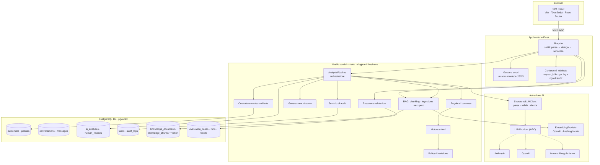
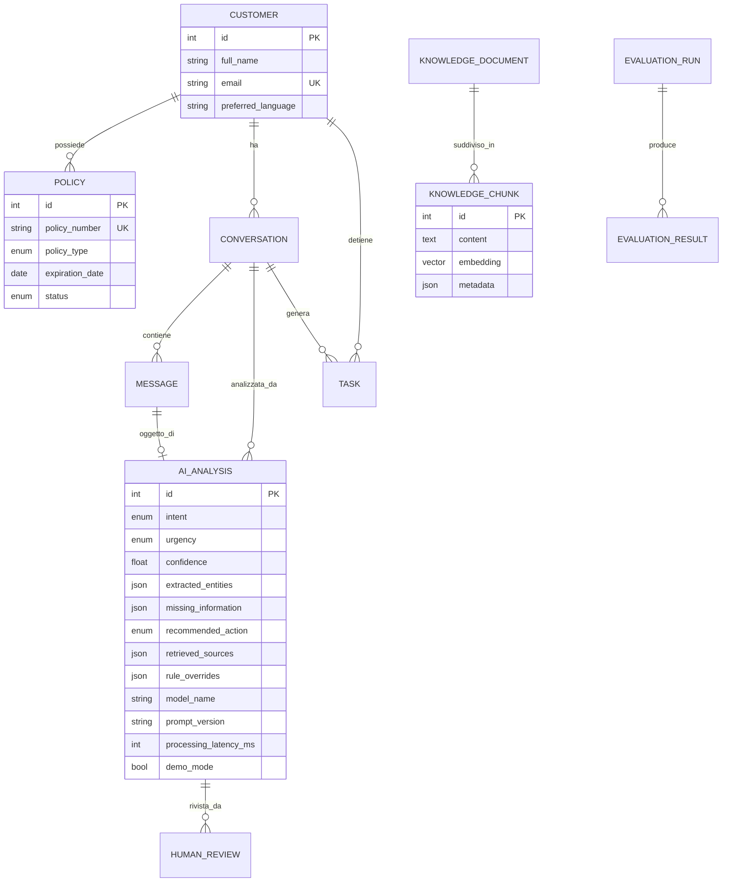
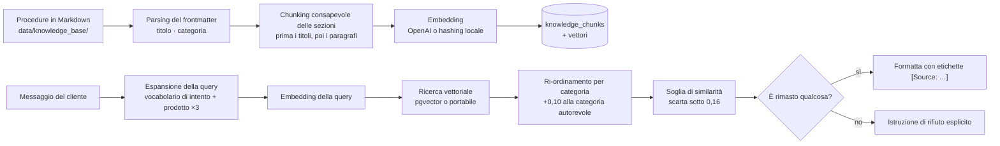

# Architettura

*Traduzione italiana di [`docs/ARCHITECTURE.md`](../ARCHITECTURE.md).*

Questo documento spiega come il sistema è messo insieme e, cosa più importante,
**perché** — inclusi i compromessi che difenderei in revisione e quelli che
riconsidererei per la produzione.

---

## 1. Principio guida

> L'LLM è un componente dentro un flusso di lavoro aziendale controllato, non il
> flusso di lavoro stesso.

Tutto ciò che segue discende da qui. Il modello è bravo a leggere prosa spagnola
disordinata e a trasformarla in struttura. Non è un sistema di registrazione, non
è stabile fra un'esecuzione e l'altra, e non può essere ritenuto responsabile.
Quindi il sistema lo usa per ciò in cui è bravo e mette codice deterministico e
testabile attorno a ogni decisione che ha conseguenze.

---

## 2. Panoramica dei componenti



### Responsabilità dei livelli

| Livello | Possiede | Non fa mai |
|---|---|---|
| **Route** | Parsing HTTP, validazione, serializzazione, codici di stato | Logica di business, chiamate AI dirette |
| **Servizi** | Tutte le decisioni, la persistenza, l'orchestrazione | Sapere che esiste HTTP |
| **Astrazione AI** | Parlare con i fornitori, parsing JSON, ritentativi | Decisioni di business |
| **Modelli** | Schema, relazioni, forma di serializzazione | Logica di flusso |
| **CLI (`app/cli.py`)** | Passi di setup riproducibili | Qualsiasi cosa serva anche all'API |

I gestori di route sono deliberatamente noiosi.
`POST /api/conversations/:id/analyze` è circa 40 righe: carica, valida, protegge
dai duplicati, delega alla pipeline, serializza. È questo che rende la pipeline
testabile senza HTTP e le route esaminabili a colpo d'occhio.

`create_app()` è solo cablaggio — estensioni, CORS, lo stack AI, i blueprint, i
gestori di errore. I comandi CLI vivono in `app/cli.py` così che la factory
resti un elenco breve, leggibile dall'inizio alla fine.

`AnalysisPipeline.analyze_conversation()` segue la stessa regola: si legge come
quattro passi con un nome (`_save_analysis` → `_route_conversation` →
`_create_task` → `_audit`) dentro un'unica transazione, invece che come una lunga
funzione che mescola persistenza, instradamento e audit.

---

## 3. Modello dati



### Perché storage relazionale

Il dominio è relazionale. Una polizza appartiene esattamente a un cliente, un
messaggio esattamente a una conversazione, una revisione esattamente a
un'analisi. Sono chiavi esterne con garanzie di integrità reali, non documenti che
per caso si riferiscono l'uno all'altro. Le query di cui il prodotto ha davvero
bisogno — «conversazioni aperte per team», «polizze in scadenza entro 30 giorni»,
«analisi in attesa di revisione» — sono normale SQL.

I vettori vivono in **una colonna di una tabella**. Tenerli nello stesso database
significa che un risultato di recupero e il record di business a cui si riferisce
distano una join, con una transazione e un backup. Un database vettoriale separato
sarebbe un secondo sistema da far girare, mettere in sicurezza e mantenere
coerente, senza alcun beneficio a questa scala.

### Perché l'output AI è una tabella di prima classe e non un blob JSON sulla conversazione

`ai_analyses` memorizza il nome del modello, la versione del prompt, la latenza,
il numero di tentativi di validazione, gli override di regola scattati e i chunk
esatti che sono stati recuperati. È questo che rende rispondibile la domanda
*«perché il sistema ha raccomandato questo, sei mesi fa?»*. Rianalizzare aggiunge
una riga invece di sovrascriverne una, quindi lo storico resta intatto.

### Due decisioni di portabilità

1. **Gli enum sono `VARCHAR` + `CHECK`, non enum nativi PostgreSQL.**
   Gli enum nativi rendono dolorose le migrazioni (`ALTER TYPE` non può stare
   nella stessa transazione di altro DDL), e ci si aspetta che questa tassonomia
   cresca. Il vincolo di check dà la stessa sicurezza senza alcun dolore
   migratorio.

2. **`knowledge_chunks.embedding` è un tipo di colonna consapevole del dialetto.**
   Compila a un vero `vector(n)` su PostgreSQL e a JSON altrove
   (`app/models/base.py`). La conseguenza — la dimensione è fissata al momento
   della migrazione — è un vincolo reale, documentato in `.env.example`: cambiare
   fornitore di embedding richiede una migrazione e una re-ingestione completa.

---

## 4. L'astrazione AI

```
LLMProvider (ABC)
├── AnthropicProvider     # adattatore sottile
├── OpenAIProvider        # adattatore sottile, modalità JSON
└── DemoProvider          # motore di regole deterministico, stesso contratto
        ↑
StructuredLLMClient       # parse → valida → ritenta → fallisci in sicurezza
        ↑
AnalysisPipeline          # non importa mai un SDK di fornitore
```

Le classi provider non contengono **nessuna costruzione di prompt, nessun parsing
e nessuna logica di business** — solo «manda queste stringhe, restituisci quella
stringa, traduci gli errori». Tutto il comportamento interessante è in
`StructuredLLMClient`, che è agnostico rispetto al fornitore e quindi testato una
volta sola per tutti.

Il provider demo è la prova che l'astrazione è reale: soddisfa la stessa
interfaccia senza alcuna rete.

**Come il mock ricostruisce la struttura.** Un provider riceve solo due stringhe,
quindi la DEMO MODE deve capire cosa le si sta chiedendo. Legge esattamente due
marcatori leggibili a macchina che il renderer dei prompt emette e che questo
progetto possiede — i delimitatori
`<<<CUSTOMER_MESSAGE_START ... CUSTOMER_MESSAGE_END>>>` e le etichette di
citazione `[Source: ...]` — e deriva tutto il resto (intento, informazioni
mancanti) eseguendo lo stesso `demo_rules.analyse()` sul messaggio estratto.
Deliberatamente **non** fa il parsing della prosa del prompt: una versione
precedente si agganciava alla frase inglese «Missing information we need from the
customer», il che avrebbe silenziosamente rotto la demo la prima volta che
qualcuno avesse riformulato un prompt.

**Compromesso:** l'interfaccia è deliberatamente minimale — una sola chiamata
`complete(system, user)`. Niente streaming, niente tool use, niente multi-turno.
Ciascuna di queste cose avrebbe bisogno di una ragione per esistere, e questo
flusso non ne ha bisogno: una classificazione è una singola chiamata il cui output
è consumato da codice, non letto mentre arriva.

---

## 5. Perché le regole deterministiche completano l'LLM

Questa è la decisione di progetto più importante del progetto.

Considera: *«Se me ha devuelto el recibo del seguro del coche.»* («Mi è tornata
indietro la ricevuta dell'assicurazione auto.») L'urgenza corretta non è una
proprietà della frase — dipende da dati che il messaggio non contiene. Se la
polizza scade fra nove giorni, la copertura sta per decadere e questo è `HIGH`.
Se scade fra otto mesi, è un `MEDIUM` di routine.

Un LLM a cui si desse il contesto cliente potrebbe azzeccarci. Potrebbe anche
azzeccarci lunedì e sbagliare martedì, e non c'è modo di scrivere uno unit test
per «di solito». Quindi:

- **Il modello riporta cosa dice il messaggio.** Urgenza di base, fatti estratti,
  cosa manca.
- **`business_rules.py` decide cosa ne fa il broker**, leggendo lo stato reale
  della polizza dal database.

Ogni regola è una funzione con un nome, una costante di soglia, una stringa di
motivazione e uno unit test. `renewal_imminent` scatta quando
`days_to_expiration <= 7`. Questo è leggibile da un responsabile compliance e
modificabile senza toccare un prompt.

**Le regole alzano soltanto l'urgenza, non la abbassano mai.** Un modello che
sovrastima la gravità costa cinque minuti a un operatore. Un modello che
sottostima un ferito costa molto di più. L'asimmetria è deliberata, e il suo costo
è misurato — la suite di valutazione riporta il tasso di falsi allarmi accanto al
recall di sicurezza.

---

## 6. Design del RAG



**Chunking sulle sezioni, non su finestre fisse.** Le procedure assicurative sono
strutturate («3. Documentación obligatoria»), e quella struttura è esattamente ciò
che rende una citazione utile a un operatore. Una finestra scorrevole taglierebbe
a metà gli elenchi di requisiti e citerebbe «chunk 7».

**Espansione della query.** Un messaggio WhatsApp grezzo è una query scadente
contro un manuale di procedure, quindi il vocabolario di dominio dell'intento
classificato viene aggiunto una volta. Una versione precedente lo ripeteva tre
volte per pesarlo di più nell'embedder a sacco di feature; misurando è emerso che
questo peggiorava l'accuratezza del documento top-1 (4/5 contro 5/5 su un insieme
verificato a mano), quindi è stato rimosso.

**Ri-ordinamento per categoria.** Un piccolo, esplicito bonus di `+0,10` per i
chunk la cui categoria di documento corrisponde all'intento — un ibrido leggero fra
similarità vettoriale e metadati del documento. È questo, non la pesatura
dell'espansione, ciò che effettivamente sistema il recupero con l'embedder
lessicale a hashing, dove i documenti condividono vocabolario comune («plazo»,
«documentación», «comunicación»).

**Una soglia di similarità, così «niente» è una risposta vera.** Sotto la soglia i
risultati vengono scartati invece che restituiti debolmente. È questo che permette
al generatore di risposta di rifiutare onestamente invece di citare una procedura
irrilevante.

**Compromesso:** il vector store portabile carica ogni chunk in Python e li ordina
lì. È O(n) per query ed è ovviamente sbagliato oltre qualche migliaio di chunk —
ed è per questo che pgvector è il percorso Docker. L'interfaccia è identica; cambia
solo l'implementazione, selezionata dal dialetto del database.

---

## 7. Human-in-the-loop

La necessità di revisione è calcolata da `review_policy.py` a partire da quattro
input: classe di rischio dell'intento, urgenza, confidenza e se la bozza è
ancorata. È codice, non una chiamata a un modello, perché *«un umano deve
guardare questo?»* è una regola di governance che qualcuno approva formalmente.

```
Richiede sempre revisione:
  · CLAIM, COMPLAINT, CANCELLATION, PAYMENT   (conseguenze legali/finanziarie)
  · urgenza >= HIGH
  · confidenza < AI_CONFIDENCE_THRESHOLD
  · intento UNKNOWN
  · qualsiasi flag di sicurezza
  · bozze non ancorate o con informazioni insufficienti

*Idoneo* all'auto-approvazione (mai automatico) solo quando valgono TUTTE:
  · intento in {POLICY_INFORMATION, DOCUMENT_REQUEST, GENERAL_SUPPORT}
  · confidenza >= soglia
  · urgenza <= MEDIUM
  · la bozza è ancorata a fonti recuperate
  · non è modalità demo
```

Nota che la modalità demo rimuove l'idoneità all'auto-approvazione ma **non**
aggiunge una motivazione di revisione. È deliberato: `required` misura la policy di
governance in sé, e deve restare confrontabile fra esecuzioni di valutazione in
modalità demo e con LLM reale. Rendere l'output mock non idoneo
all'auto-approvazione è il controllo che conta davvero.

Nulla viene mai inviato. `HumanReview.simulated_send` registra l'*intenzione* di
inviare, e una riga di audit segna `delivery: SIMULATED_ONLY`. Collegare un canale
reale sostituirebbe una sola funzione.

---

## 8. Tracciabilità

Un solo helper, `record_audit()`, usato ovunque, così che le voci non possano
derivare verso forme incoerenti. Mette in stage la riga dentro la transazione del
chiamante — un record di audit e la cosa che descrive vengono committati insieme
o non vengono committati affatto.

Ogni voce porta il `request_id` della richiesta HTTP, che compare anche in ogni
riga di log. Una raccomandazione nel database può essere ricondotta alla richiesta
esatta e ai suoi log.

**I corpi dei messaggi e le bozze di risposta non vengono mai scritti nell'audit
trail.** `_sanitise()` li rimuove per chiave. I dati qui sono sintetici, ma il
codice è scritto come se non lo fossero.

---

## 9. Architettura frontend

Deliberatamente piccola: un `api/client.ts` tipizzato, un hook `useApi` di ~60
righe, componenti-pagina e primitive di presentazione.

**Niente react-query, niente Redux.** Otto schermate con semplici esigenze di
richiesta/refetch non giustificano nessuno dei due. L'hook gestisce le due cose
che mordono davvero — la sicurezza allo smontaggio e l'ordinamento delle risposte
obsolete (una richiesta precedente che si risolve dopo una successiva). Se
servissero caching o aggiornamenti ottimistici, il compromesso si ribalterebbe.

**Nessuna libreria di componenti.** ~700 righe di CSS con design token, contro una
dipendenza il cui sistema di temi chi esamina il codice dovrebbe imparare. Per uno
strumento interno con questa superficie, il CSS è più piccolo di quanto sarebbe la
configurazione.

**Nessun livello di API mockate.** Ogni schermata parla con il backend reale. Un
frontend mockato nasconde i bug di integrazione, che sono quelli che contano.

Lo stato scende dalla pagina. Dopo un'analisi o una revisione l'intera
conversazione viene ricaricata invece che aggiornata localmente, perché il backend
possiede le transizioni di stato, la creazione dei task e le voci di audit —
ricostruirlo lato client significherebbe duplicare logica di business in
TypeScript.

---

## 10. Compromessi architetturali noti

| Compromesso | Perché è accettabile qui | Cosa serve in produzione |
|---|---|---|
| L'inbox filtra le etichette AI in Python | L'intento vive sull'ultima analisi; un filtro SQL richiederebbe una subquery correlata «l'ultima per conversazione». Non ne vale la pena a volumi da POC. | `latest_analysis_id` denormalizzato su `conversations`, o una vista materializzata |
| Analisi sincrona dentro la richiesta HTTP | La latenza è ~100 ms in modalità demo, qualche secondo con un modello reale. Accettabile per un'azione avviata da un operatore. | Coda di job con ritentativi e dead-lettering |
| Dimensione dell'embedding fissata alla migrazione | Una migrazione, chiaramente documentata | Dimensione per collezione, o un servizio vettoriale dedicato |
| Mono-tenant, un solo operatore hardcoded | L'autenticazione è esplicitamente fuori perimetro per questo POC | SSO + RBAC, identità reale nell'audit trail |
| Registro dei prompt caricato da disco all'import | I prompt sono adiacenti al codice e sotto controllo di versione | Idem, più un gate CI sulle metriche di valutazione al cambio di prompt |

Nulla qui è nascosto dietro un'astrazione che finge di risolverlo. Ciascuno è un
pezzo di lavoro dimensionato e nominato.
