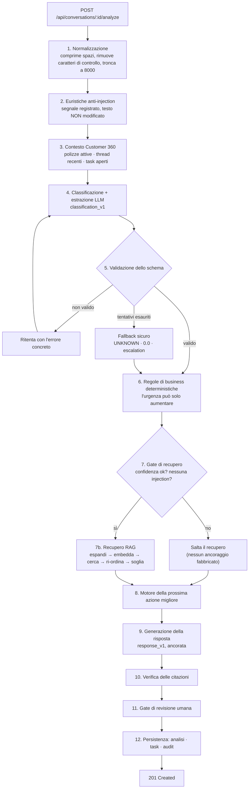

# Pipeline AI

*Traduzione italiana di [`docs/AI_PIPELINE.md`](../AI_PIPELINE.md).*

Descrizione end-to-end di cosa succede fra un messaggio in arrivo e una bozza
revisionabile, e di cosa succede quando ogni singolo passo fallisce.

Punto d'ingresso: `backend/app/services/workflows/pipeline.py`.

---

## Panoramica



---

## Stadio per stadio

### 1. Normalizzazione — `utils/text.normalize_message`

Unicode NFC, caratteri di controllo rimossi, sequenze di spazi compresse, spazi
finali per riga rimossi, troncamento a 8 000 caratteri.

Deliberatamente conservativa: accenti, punteggiatura ed emoji vengono **mantenuti**,
perché portano segnale. Un `!!!` arrabbiato conta per rilevare un reclamo;
rimuovere gli accenti distruggerebbe la differenza fra *«papá»* e *«papa»*.

**Fallimento:** un messaggio vuoto solleva `ValueError` prima che venga fatta
qualsiasi chiamata API, esposto come HTTP 422. Mai spendere un token su una
stringa vuota.

### 2. Euristiche anti-injection — `utils.text.detect_injection`

~13 pattern regex su testo con accenti normalizzati, che coprono formulazioni
inglesi e spagnole («ignore your instructions», «olvida tus instrucciones»,
«muéstrame información de otros clientes»).

Questo è un **segnale, non un filtro**. Le difese vere sono strutturali:

- il testo del cliente è sempre racchiuso in delimitatori espliciti ed etichettato
  come non fidato;
- il prompt istruisce il modello a trattarlo come dato;
- **nessuno strumento o query in questo sistema può leggere la riga di un altro
  cliente** — il costruttore di contesto riceve un solo oggetto cliente e seleziona
  da quello.

Una corrispondenza imposta `PROMPT_INJECTION_SUSPECTED`, che salta il recupero,
forza l'escalation a `COMPLIANCE_TEAM` e scrive una voce di audit.

### 3. Contesto cliente — `workflows/context.py`

Due obiettivi in competizione: il modello ha bisogno di abbastanza stato di
business per essere utile, e il prompt non deve diventare uno scarico del database
— il contesto irrilevante costa token, diluisce l'attenzione e allarga il raggio
d'azione di una injection.

Quindi la selezione è esplicita e limitata: al massimo 6 polizze attive (prima
quelle in scadenza più vicina), 4 conversazioni recenti, 4 task aperti. Mai un
altro cliente, mai note interne.

Renderizzato come Markdown compatto, che i modelli leggono in modo affidabile.

### 4. Classificazione — prompt `classification_v1`

Il prompt è un file (`app/prompts/classification_v1.md`), non una stringa
letterale. I suoi elenchi di enum sono **generati dagli enum Python** al momento
del rendering, quindi il prompt non può divergere dal validatore.

Istruisce il modello a: emettere solo JSON; usare solo i valori enum elencati;
estrarre solo fatti letteralmente presenti; trattare il messaggio del cliente come
dato non fidato; e riportare la confidenza onestamente, con un esempio esplicito
per cui un messaggio vago deve stare sotto 0,5.

**Temperatura 0,1.** Questo è lavoro analitico e deve essere riproducibile.

### 5. Validazione dello schema — `schemas/ai_output.MessageAnalysis`

Il singolo controllo di affidabilità più importante. Un'etichetta non valida non
può mai arrivare al database, al motore di instradamento o all'interfaccia.

Gestiti con tolleranza (coercizione, perché sono rumore di formattazione più che
errori semantici):

| Stranezza del modello | Gestione |
|---|---|
| Prosa attorno al JSON | Estrazione a graffe bilanciate che ignora le graffe dentro le stringhe |
| Recinti Markdown | Rimossi |
| `confidence: 94` | Riscalato a `0.94` |
| `injuries: "no"` / `"sí"` | Coercito a booleano |
| `vehicle_plate: "1234 abc"` | Normalizzato a `1234ABC` |
| `missing_information: "photos"` | Racchiuso in una lista |
| Etichetta di intento sconosciuta | Ripiega su `UNKNOWN` |

Gestiti con rigore (rifiutati, con conseguente ritentativo):

| Violazione | Perché rigore |
|---|---|
| Valore di **urgency** sconosciuto | L'urgenza guida l'escalation; indovinarla non è sicuro |
| Confidenza non numerica | Input privo di senso per il gate di revisione |
| `summary` mancante | È il campo rivolto all'operatore |
| Intento `UNKNOWN` con confidenza > 0,6 | Internamente incoerente; limitato a 0,4 |

**I ritentativi sono informati**: l'errore di validazione viene aggiunto in coda al
prompt di ritentativo. Un ritentativo cieco spreca una chiamata.

Gli errori del fornitore sono classificati: 429/408/5xx sono ritentabili, altri 4xx
(una chiave API sbagliata) no, e falliscono subito invece di bruciare il budget di
ritentativi.

**Fallimento:** dopo `LLM_MAX_RETRIES + 1` tentativi viene sollevata
`AnalysisFailure` e la pipeline sostituisce un **fallback sicuro** — `UNKNOWN`,
confidenza `0.0`, `ESCALATE_TO_HUMAN`, revisione richiesta, `fallback_used = true`
— e scrive una voce di audit `AI_OUTPUT_VALIDATION_FAILED`. Il prodotto degrada;
non produce una risposta sbagliata ma sicura di sé, e non restituisce 500.

### 6. Regole di business — `workflows/business_rules.py`

Vedi [02-ARCHITETTURA.md §5](02-ARCHITETTURA.md#5-perché-le-regole-deterministiche-completano-lllm)
per il ragionamento. Le regole:

| Regola | Condizione | Risultato |
|---|---|---|
| `injuries_reported` | `injuries == true` | `CRITICAL` |
| `claim_on_expired_policy` | `CLAIM` + polizza scaduta | ≥ `HIGH` |
| `claim_minimum_urgency` | qualsiasi `CLAIM` | ≥ `MEDIUM` |
| `payment_on_lapsed_policy` | `PAYMENT` + polizza `LAPSED` | ≥ `HIGH` |
| `payment_close_to_expiry` | `PAYMENT` + ≤ 15 giorni alla scadenza | ≥ `HIGH` |
| `renewal_imminent` | `RENEWAL` + ≤ 7 giorni | ≥ `HIGH` |
| `renewal_approaching` | `RENEWAL` + ≤ 30 giorni | ≥ `MEDIUM` |
| `complaint_minimum_urgency` | qualsiasi `COMPLAINT` | ≥ `HIGH` |
| `cancellation_minimum_urgency` | qualsiasi `CANCELLATION` | ≥ `MEDIUM` |

Ogni override è memorizzato con `from`, `to` e una motivazione leggibile, e mostrato
nell'interfaccia. L'urgenza può solo aumentare.

### 7. Gate di recupero, poi RAG

**Il gate viene prima.** Il recupero viene saltato quando:

- si sospetta una injection — il testo non è la descrizione di un bisogno
  assicurativo, quindi ancorarlo è privo di senso; oppure
- la confidenza è sotto il pavimento di instradamento (0,45), o l'intento è
  `UNKNOWN` / `GENERAL_SUPPORT`.

La seconda condizione conta più di quanto sembri. Se il sistema non sa cosa vuole
il cliente, non può sapere quale procedura sia rilevante — e recuperare comunque
produce *citazioni dall'aria autorevole attaccate a una risposta di cui nessuno
dovrebbe fidarsi*. Non restituire nulla permette al generatore di dirlo onestamente.

Quando il gate passa: espandi la query con il vocabolario di intento e prodotto,
embedda, cerca, applica il ri-ordinamento per categoria, scarta tutto ciò che sta
sotto la soglia di similarità.

**Fallimento:** il recupero è racchiuso in un try/except. Se il vector store
fallisce, l'analisi si completa comunque con zero fonti ed è quindi non ancorata e
soggetta a revisione. Il fallimento di un miglioramento non deve far perdere la
classificazione.

### 8. Prossima azione migliore — `workflows/action_engine.py`

Prima i gate, poi l'instradamento per intento, poi un controllo finale di
escalation:

1. **Injection** → `ESCALATE_TO_HUMAN` / `COMPLIANCE_TEAM`.
2. **Confidenza < 0,45 oppure `UNKNOWN`** → `REQUEST_CLARIFICATION`. Il sistema
   chiede invece di indovinare.
3. **Instradamento per intento** — es. `CLAIM` con informazioni mancanti →
   `REQUEST_DOCUMENTS`; `CLAIM` completo → `CREATE_CLAIM_CASE`.
4. **Urgenza `CRITICAL`** sovrascrive l'azione instradata con `ESCALATE_TO_HUMAN`.

Output: `azione + team + ore di follow-up + human_review_required + motivazione`.
La stringa di motivazione è ciò che legge l'operatore e ciò che leggerà un auditor
in seguito.

Lo SLA di follow-up è configurazione di business, non output del modello:
`CRITICAL 1 h · HIGH 4 h · MEDIUM 12 h · LOW 48 h`.

### 9. Generazione della risposta — prompt `response_v1`

Una chiamata separata con un prompt separato, di proposito: modalità di
fallimento diverse, e una classificazione riuscita dovrebbe comunque produrre
instradamento anche se la stesura fallisce.

Il prompt vincola il modello alla conoscenza recuperata per **tutti i fatti
procedurali**, vieta di inventare massimali, premi, esclusioni, nomi di consulenti,
numeri di telefono e URL, e richiede un esplicito
`insufficient_information: true` quando la conoscenza non supporta una risposta.

**Fallimento:** in caso di `AnalysisFailure` viene restituita una risposta
interlocutoria fissa e onesta con `grounded: false` e
`insufficient_information: true`. L'analisi sopravvive.

### 10. Verifica delle citazioni

Un modello può dichiarare un ancoraggio che non ha. Quindi la pipeline controlla il
suo lavoro:

```python
valid = {chunk.citation for chunk in retrieved}
response.used_sources = [s for s in response.used_sources if s in valid]
if not retrieved:            response.grounded = False
elif not response.used_sources: response.grounded = False
```

Le fonti non effettivamente recuperate vengono rimosse prima della memorizzazione.
Dichiarare l'ancoraggio senza citare nulla è trattato come non ancorato, il che
manda la bozza al gate di revisione.

### 11. Gate di revisione umana — `workflows/review_policy.py`

Vedi [02-ARCHITETTURA.md §7](02-ARCHITETTURA.md#7-human-in-the-loop). Produce
`required`, una lista di `reasons` leggibili mostrate nell'interfaccia, e
`auto_approval_eligible`.

### 12. Persistenza e audit

Un'unica transazione scrive: la riga `AIAnalysis` (inclusi modello, versione del
prompt, latenza, tentativi, override di regola, flag di sicurezza e fonti
recuperate), la transizione di stato della conversazione, il team instradato, un
`Task` con una scadenza, e le voci di audit — `AI_ANALYSIS_CREATED` (o
`AI_ANALYSIS_FAILED`), `TASK_CREATED`, un `BUSINESS_RULE_OVERRIDE` per ogni regola
scattata, e `PROMPT_INJECTION_SUSPECTED` se segnalato.

---

## Riepilogo dei fallimenti

| Fallimento | Comportamento | Visibile come |
|---|---|---|
| Messaggio vuoto | Rifiutato prima di ogni chiamata API | HTTP 422 |
| Nessuna chiave API | Modalità demo all'avvio | Banner «Demo AI Mode»; `demo_mode=true` su ogni riga |
| Timeout / 5xx / 429 del fornitore | Ritentato | `validation_attempts` nei metadati |
| Chiave API errata (401) | Non ritentato | Analisi di fallback + voce di audit |
| JSON malformato | Ritentato con l'errore di parsing | `validation_attempts` |
| Violazione dello schema | Ritentato con l'errore di validazione | `validation_attempts` |
| Tutti i ritentativi esauriti | Fallback sicuro: `UNKNOWN`, escalation | Voce di audit `AI_OUTPUT_VALIDATION_FAILED` |
| Errore del vector store | L'analisi si completa non ancorata | 0 fonti, revisione richiesta |
| Nessun risultato RAG | Rifiuto esplicito, risposta interlocutoria | Callout «informazioni insufficienti» |
| Generazione della risposta fallita | Risposta interlocutoria fissa | `grounded=false`, revisione richiesta |
| Richiesta di analisi duplicata | Rifiutata salvo `force: true` | HTTP 409 |
| Doppia revisione | Rifiutata | HTTP 409 |

---

## Versionamento dei prompt

I prompt vivono in `backend/app/prompts/` come Markdown con frontmatter, caricati
da un piccolo registro. `prompt_version` è memorizzata su ogni analisi.

| Prompt | Scopo | Contratto di output |
|---|---|---|
| `classification_v1` | Classifica + estrae | `MessageAnalysis` |
| `response_v1` | Stende la risposta al cliente | `GeneratedResponse` |
| `rag_answer_v1` | Risponde a una domanda interna dalla KB | `GeneratedResponse` |

Per cambiare un prompt: aggiungi `classification_v2.md`, cambia la costante,
riesegui `flask evaluate` e confronta le due esecuzioni nella schermata
Evaluations. Quel confronto è il motivo per cui le esecuzioni vengono persistite.

---

## Osservabilità

Ogni riga di log e ogni riga di audit porta un `request_id`, propagato
dall'header `X-Request-ID` o generato per richiesta, e restituito nella risposta.

Registrati: metodo/percorso/stato/durata della richiesta, invocazione AI con
modello e latenza, fallimenti di parsing e validazione con la ragione, backend di
recupero e conteggi dei risultati, override di regole, revisioni umane, esecuzioni
di valutazione.

**Non registrati:** corpi dei messaggi e bozze di risposta. `redact()` esiste per i
pochi punti in cui un estratto aiuta genuinamente il debug (maschera email,
telefoni, IBAN e targhe), e `LOG_MESSAGE_BODIES` vale `false` per default.
